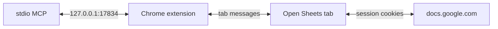

# gsheets-session MCP

Read, write, inspect selections, and compare revision versions of a Google Sheet
using your **existing Chrome session**. No OAuth client, API key, GCP project, or
repeated cookie capture. This works for sheets shared with a visitor-session
(invite-only) non-Google account, where the v4 Sheets API is not available.

An unpacked Chrome extension performs reads and saves inside an open Sheets tab.
Google cookies and session tokens stay in the browser; the MCP process sees only
sheet data and commands over a loopback-only WebSocket.

## How it works



- **Reads:** the tab requests gviz CSV (`/gviz/tq`), which uses the browser's
  current session cookies.
- **Writes:** the MCP builds the existing `/save` mutation bundles; the tab adds
  fresh `info_params` (`token`, `ouid`) and POSTs the same-origin request. The
  server's operational transform preserves concurrent edits elsewhere.
- **Selections:** the tab reads the active A1 range from the name box and visible
  collaborator presence. Values for that range are fetched through gviz.
- **Revision list:** the tab fetches the editor's `/revisions/tiles` JSON;
  timestamps, authors, revision ranges, and version names are mapped in Node.
- **Revision diff:** full revision snapshots are fetched and parsed into cell maps;
  the MCP returns only changed cells as `{cell, before, after, kind}`.
- **Activity:** the extension captures `/streamrows` request bodies via
  `webRequest`, batches them per sheet and `snapshotAt`, and sends the URL/body to
  the MCP. The MCP replays each request inside the tab and decodes the response
  into changed cells (`lib/streamrows.mjs`). It appends decoded channel values
  under `event.channel` and still uses revision diffs for exact before/after values
  and authors.

There is no official Sheets API path for this setup: the API requires OAuth, and
live selection plus version-history cell snapshots are not exposed through it.
The implementation avoids UI automation and reads only these narrow tab values.

## Setup

1. Install dependencies:
   ```
   pnpm install
   ```
2. Create the config from the template. The MCP needs only the spreadsheet ID and
   tab gid:
   ```json
   {
     "spreadsheetId": "YOUR_SPREADSHEET_ID",
     "gid": "0",
     "activity": {
       "maxEvents": 200,
       "maxChangesPerEvent": 500,
       "maxMemoryMb": 8
     }
   }
   ```
   `activity` is optional; omitted fields use those defaults. Memory is measured
   as approximate UTF-8 JSON size, not V8 heap overhead. Optional `sid`, `rev`,
   and `reqId` values retain an accepted save session. Existing `cookie`, `token`,
   and `ouid` fields are ignored by the MCP.
3. Open `chrome://extensions`, enable **Developer mode**, choose **Load unpacked**,
   and select the `extension/` directory. Keep the extension enabled. After
   updating files in `extension/`, use the extension's **Reload** button so Chrome
   drops its cached script version.
4. Keep the target spreadsheet open in that Chrome profile. No reload is needed
   for tabs that were already open; the extension injects its tab client on demand.
5. Register the MCP server with your client as before, pointing at the absolute
   path of `server.mjs` (for example `node /path/to/server.mjs`).

When the Google session expires, sign in to Chrome and reload the sheet. The
bridge reconnects automatically and the MCP keeps working without editing the
config or recapturing a request.

## Tools

| Tool | Input | Output |
| --- | --- | --- |
| `read_range` | `{range?}` | `{rows: string[][]}` from gviz |
| `write_cells` | `{edits: [{a1, value}]}` | `{written, rev}`; atomic save |
| `clear_cells` | `{cells: [a1]}` | `{written, rev}`; writes empty strings |
| `get_selection` | `{includeValues?}` | active range, up to 2000 cell values, viewers with status |
| `list_revisions` | `{limit?}` | newest-first versions with timestamp, authors, range, name |
| `diff_revisions` | `{fromRevision, toRevision, range?, maxChanges?}` | structured cell changes and summary |
| `get_activity` | `{limit?, since?}` | in-memory live activity events with revision, authors, and cell changes |

`get_selection` example:

```json
{
  "range": "A2",
  "selectionBy": "current-tab",
  "viewers": [{ "name": "Jordan Lee", "status": "inactive", "label": "Jordan Lee (inactive)" }],
  "values": [["Date"]]
}
```

`list_revisions` entries use the end revision as the version identifier:

```json
{
  "revision": 71,
  "range": { "start": 37, "end": 71 },
  "timestamp": "2026-11-03T09:07:04.682Z",
  "authors": ["Jordan Lee", "sam.carter@example.com"],
  "name": null,
  "expandable": true
}
```

Pass those revisions to `diff_revisions`; results are ordered by row then column:

```json
{
  "summary": { "changed": 4, "added": 2, "removed": 2, "returned": 4, "truncated": false },
  "changes": [
    { "kind": "removed", "cell": "H3", "before": "Old task", "after": null },
    { "kind": "added", "cell": "H5", "before": null, "after": "Onboarding: accounts" },
    { "kind": "changed", "cell": "I5", "before": "4", "after": "8" }
  ]
}
```

Use `range` to limit a large diff and `maxChanges` to cap the returned list while
keeping full counts in `summary`.

`get_activity` returns events accumulated while the MCP is running. Poll it with
the previous newest event's `time` as `since`:

```json
{
  "trackingRevision": 259,
  "total": 1,
  "limits": { "maxEvents": 200, "maxChangesPerEvent": 500, "maxMemoryMb": 8, "maxMemoryBytes": 8388608 },
  "sizeBytes": 612,
  "events": [{
    "time": "2026-11-03T12:10:21.604Z",
    "revision": 259,
    "fromRevision": 258,
    "authors": ["sam.carter@example.com", "Jordan Lee"],
    "summary": { "changed": 1, "added": 1, "removed": 0, "returned": 1, "truncated": false },
    "changes": [{ "kind": "added", "cell": "K1", "before": null, "after": "activity-trigger-probe" }]
  }]
}
```

## Limits / caveats

- **Strings and numbers only** for writes. Native formula edits use a separate
  structured formula/token payload; writing `=1+1` through the string value type
  stores literal text, not a formula. Values beginning with `=` are rejected.
- **Clearing** writes `""`, which reads as blank but is not a true content-delete.
- **Selection scope:** only the local tab's selected range is stable. Collaborator
  presence names/status are returned, but live remote cursor ranges are not exposed
  by a stable interface. A local selection larger than 2000 cells omits `values`;
  call `read_range` for it.
- **Revision diffs** compare displayed cell values, not formatting, comments, or
  charts. Revision snapshots can be large; diffs are capped by `maxChanges`.
- **Activity is in-memory and best-effort.** It is bounded by `activity.maxEvents`
  (default 200), `activity.maxChangesPerEvent` (default 500), and
  `activity.maxMemoryMb` (default 8 MB of approximate serialized JSON). Old entries
  are evicted first; an oversized event is trimmed and dropped if its metadata
  alone cannot fit. The log resets when the MCP restarts. Edits made while MCP or the extension is disconnected are not
  logged; query `list_revisions`/`diff_revisions` for the full history. It includes
  MCP-originated writes too.
- **Author attribution is revision-level.** Authors come from the covering version
  tile and can include several people; this is not per-cell blame.
- **Undocumented endpoints.** Google can change `/save`, `/revisions/tiles`, or
  `/revisions/show`. Reads already have a public-ish gviz fallback; writes and
  history may need protocol updates if Google changes the editor.
- **Security:** the bridge listens only on `127.0.0.1:17834` and accepts WebSocket
  origins beginning with `chrome-extension://`. It does not accept web-page origins.
  The extension's `webRequest` listener is restricted to Sheets URLs. It observes
  StreamRows request bodies (URL and form fields), then replays them in the tab;
  it does not expose browser cookies or response bodies on the bridge.

## Files

- `server.mjs` - stdio MCP and tool implementations
- `lib/bridge.mjs` - loopback WebSocket bridge and request queue
- `lib/activity.mjs` - bounded in-memory activity store and limits
- `lib/encode.mjs` - `/save` mutation encoder
- `lib/streamrows.mjs` - StreamRows response decoder for observed cell changes
- `extension/` - unpacked Chrome MV3 extension
- `save-write.mjs` - **legacy** standalone writer; it still uses captured
  `cookie`/`token` fields directly and is separate from the MCP path
- `test-encode.mjs` - encoder regression test
- `test-activity.mjs` - activity cap, trimming, memory, and filtering test
- `test-streamrows.mjs` - StreamRows decoder regression test

Run the offline tests with `pnpm test`.
